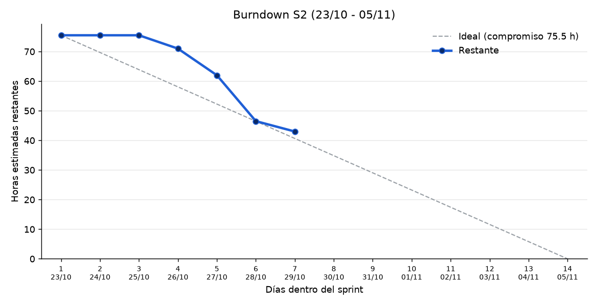
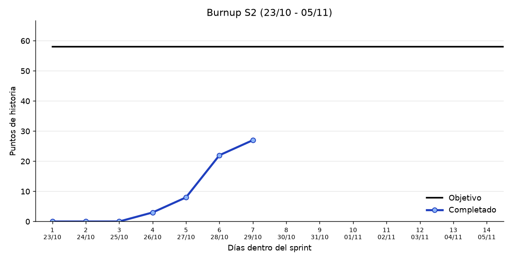

# Gestión
Repositorio para la gestión del proyecto, como el seguimiento de hitos y documentación API, de la asignatura de Gestión de Proyecto Software de la Universidad de Zaragoza.

## Contenido

- [Definición de hecho](definicion_de_hecho.md): lo que debe cumplir una PBI para darla por terminada.
- [Actas de reuniones](actas.md)
- Convenciones:
  - [Código](convenciones/reglas_codigo.md)
  - [API](convenciones/reglas_API.md)
  - [Base de datos](convenciones/reglas_base_de_datos.md)
  - [Seguridad y privacidad](convenciones/reglas_seguridad.md)
  - [Diseño móvil y accesibilidad](convenciones/reglas_responsive_movil.md)
  - [Git](convenciones/reglas_git.md)
- Calidad:
  - [Revisión de código](calidad/revision_de_codigo.md)
  - [Estrategia de pruebas](calidad/estrategia_de_pruebas.md)
  - [Prueba de humo](calidad/prueba_de_humo.md)
- [Diagramas de Gantt](diagramas/)

<!-- METRICAS:START -->
## Métricas del sprint

_Actualizado automáticamente el 29/10/2026 10:40._

### S2 (23/10 - 05/11, en curso)

Quedan **43 h** de 75.5 h estimadas · **22 / 58** puntos de historia hechos

**Pendiente de estimar:**

- S2: sin «Estimación: X h» → #256
<!-- METRICAS:END -->
